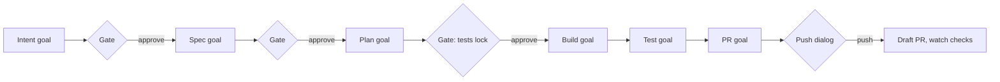

# goal-and-do: What It Does and How It Works

A prototype for private trials on your own work, on your own machine; it isn't ready for a team rollout. It tests one idea: a Claude Code mod conducts the six phases of a change, and each step runs as a `/goal`.

**State, October 31, 2026:** the five-phase version passed a full run on a demo project and on a real ticket. The six-phase version has reached the Intent gate on the demo project. Its full run is next.

## In One Minute

- **What:** `/goal-and-do <ticket or text>` takes a change through Intent, Spec, Plan, Build, Test and PR to a draft pull request.
- **How:** each phase is a `/goal`. Claude works until the phase file says `status: done`. A small evaluator model checks each time Claude would stop. A skill per phase holds the method. A mod starts the goals and holds what a model shouldn't decide alone.
- **Who decides:** you, after Intent, after Spec and after Plan, and once before the first push. Approving Plan locks the acceptance tests. Build, Test and PR run on their own. Nothing merges.
- **Safety:** a guard checks every tool call. It allows one push shape, only in the PR phase. It blocks merges, force pushes, and edits to the locked tests and CI files. The mod checks the test lock before Build and Test end and before the push. Branch protection stays the real control.
- **What you see:** a band above the prompt, a side pane, dialogs at the gates. `status` shows the full table.
- **What it measures:** tokens per phase and model, goal turns, minutes. A mod can't see the evaluator's tokens. `/usage` has them.
- **What it showed (the five-phase version, October 30, 2026):** the demo run passed all five phases. On a real ticket, Spec found where the code contradicts the ticket. Plan stopped to ask instead of guessing.

## What the Guard Reaches in 0.2.0

The guard's new rules (see the README for the list) live in `hooks/reach.ts` (environment files, credential stores, steering files, token prints, folder searches, the reviewer's `CLAUDE.md`) and `hooks/guard.ts` (outbound tools, MCP write tools, the `gh` allow list, the test run's token scrub). The mod fills the context: it lists the environment files at each phase start (`find` for all, `git ls-files` for those a default search reads), passes the approved plan's `planned-paths` and `planned-tools`, and tells the reviewer's loop from the engine's agent list. A refusal in `BLOCKING_REASONS` ends the run blocked; a refused folder search does not (temporary exception 1).

AC-13 (does Claude Code's own `Read(./.env*)` rule prompt in auto mode, or is the guard the first layer?) was a manual run, step 7 of the plan's How to Test. Result, November 1, 2026, Claude Code 2.1.316: the deny rule `Read(./.env*)` refused the read in auto mode, with no prompt. Claude Code's rule is the first layer and the guard the second, where AC-13's wording has them the other way round. The same version has no Grep tool, in the main session or in the Explore subagent, so whether that tool honours `.gitignore` could not be tried. It is rechecked when the tool returns; two scratch projects are kept for it.

## For Reviewers

- **Try it:** in a test project, type `/plugin marketplace add atra-consulting/agentic-engineering-demo` and `/plugin install goal-and-do@agentic-engineering-demo` in Claude Code. Then type `/goal-and-do <a ticket key, a browse URL, or a small request>`. Step by step, with the expected output: [`community-tests/01-install.md`](community-tests/01-install.md). You need Claude Code 2.1.314 or later.
- **Questions for you:**
  - Do the gates sit in the right places?
  - Did the Intent phase make your spec better, or just longer?
  - Is a third gate worth it?
  - Does a goal per phase work as a way to run a step?
  - Should a mod conduct, or should gates and checks live where nobody can switch them off?
  - Do the token counts work as a score to compare prototypes?

## Mod or Skill?

A **mod** is TypeScript code in a plugin. Claude Code calls it on its events: session start, each command, each turn's end, each stop, each tool call, each screen redraw. The mod can run `/goal` and `/clear`, open dialogs, read files, run processes and draw on screen. It costs no tokens. It runs with your rights, unsandboxed, so review it like any tool you install.

A **skill** is Markdown. The model reads it and decides what to do.

| | Mod | Skill |
|---|---|---|
| Who acts | Code | The model |
| Start a `/goal` | Yes | No: the Skill tool refuses `/goal` |
| Gates | A dialog waits for you | The model asks; it can skip the gate, or talk itself past it |
| Guard | Denies a tool call before it runs | Asks the model to follow rules |
| Timing | Blocks a call at the wrong time (here: a push before PR) | Asks the model to wait |
| Fresh context | Runs `/clear` between phases | Can't clear its own context |
| Turn cap | Counts turns, ends the loop | Asks the model to stop |
| Token counts | Sees every turn | Sees nothing |
| Screen | Band, pane, dialogs | Chat only |
| Restart | Restores the run | Only what the files hold |
| Runs in | Claude Code with mods allowed; policy or `claude -p` turns it off | Any session with the plugin |
| Cost | No tokens | Its text, every time |

So the mod conducts and the skills hold the method. A stricter design wants gates where a mod can't switch them off. This prototype goes past that on purpose, to measure what a conducting mod gives and costs.

## How a Run Goes

1. **Start:** the mod checks the repo, writes `changes/<id>/`, and starts the Intent goal.
2. **Phase:** the skill does the work and writes `status: done`, or `blocked` with a reason.
3. **Phase end:** the mod reads the file. After Intent, Spec and Plan it opens a gate. After Build and Test it starts the next phase. Anything else opens the stuck dialog.
4. **Gate:** you walk through the open points, approve, open the file, or stop. With open points, the walk-through comes first. At the Intent gate, approval waits until each high-risk question has an answer; "Not known yet" doesn't count. "Approve" records the file's hash in `approvals.md`.
5. **Next phase:** the mod runs `/clear` first, so each phase sees only the files.
6. **PR:** the skill reviews the diff, writes the body and pushes after your yes. Then it opens the draft PR and fixes failing checks, up to three rounds. The mod counts the rounds as fix pushes and refuses a fourth; you rerun, reset the count or raise the cap in the Stuck dialog. A failure that matches the infrastructure list is left to you to re-run.

## Under the Hood

- **Starting a goal:** a command can't run another command directly. The mod starts the first goal from a timer, the later ones when a turn ends.
- **The goal loop:** `/goal` adds an evaluator that sends Claude back until the condition holds. A goal's turns all run in one turn. The mod counts them at each stop and ends the loop at the cap (Intent 10, Spec 15, Plan 20, Build 40, Test 25, PR 60).
- **Background agents:** Claude Code runs subagents in the background. A turn that waits for one keeps the goal alive.
- **State:** `run.json` holds the run. It survives `/clear` and restarts. Claude's shell can write it, so the mod keeps the approvals and the test lock in its own store, refuses a restore when `run.json` differs from them, and rewrites `approvals.md` from the store at each gate.
- **Test lock:** the mod compares the tests with the commit from Plan approval. Any change blocks the run.
- **Guard:** it fails closed. If it throws, it blocks the call. During Intent it allows only reading, edits in the change folder, Git for the branch, and Jira reads. Shell commands that reach a file by a detour, such as `cd` first, still get past its checks of `approvals.md` and `run.json`.
- **Push:** after your yes the mod lets the PR phase's own `gh pr` calls through without a prompt.
- **Tokens:** every turn's usage goes to its phase and model. The evaluator and the auto-mode classifier stay invisible.
- **Permissions:** after you allow a call, the mod may offer a narrow rule for it. It never offers one for a write or a push.

## The Change Folder

| File | Who writes it | Committed |
|---|---|---|
| `request.md` | the mod | with the intent |
| `intent.md` | Intent; Spec commits an edit from a walk-through | yes |
| `spec.md`, `plan.md`, `build.md`, `test.md`, `pr.md` | their phases | yes |
| `approvals.md` | the mod, at each gate | at the start of Build |
| `run.json` | the mod | never |

Decisions and open questions: [`goal-and-do-design.md`](goal-and-do-design.md).
