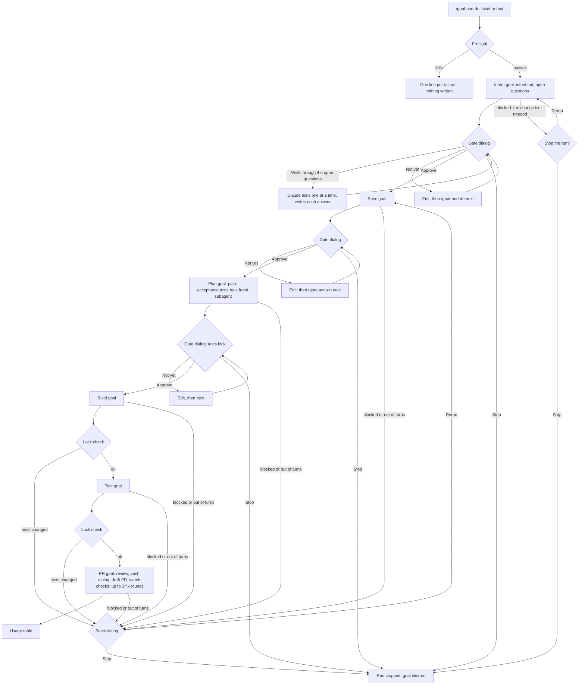
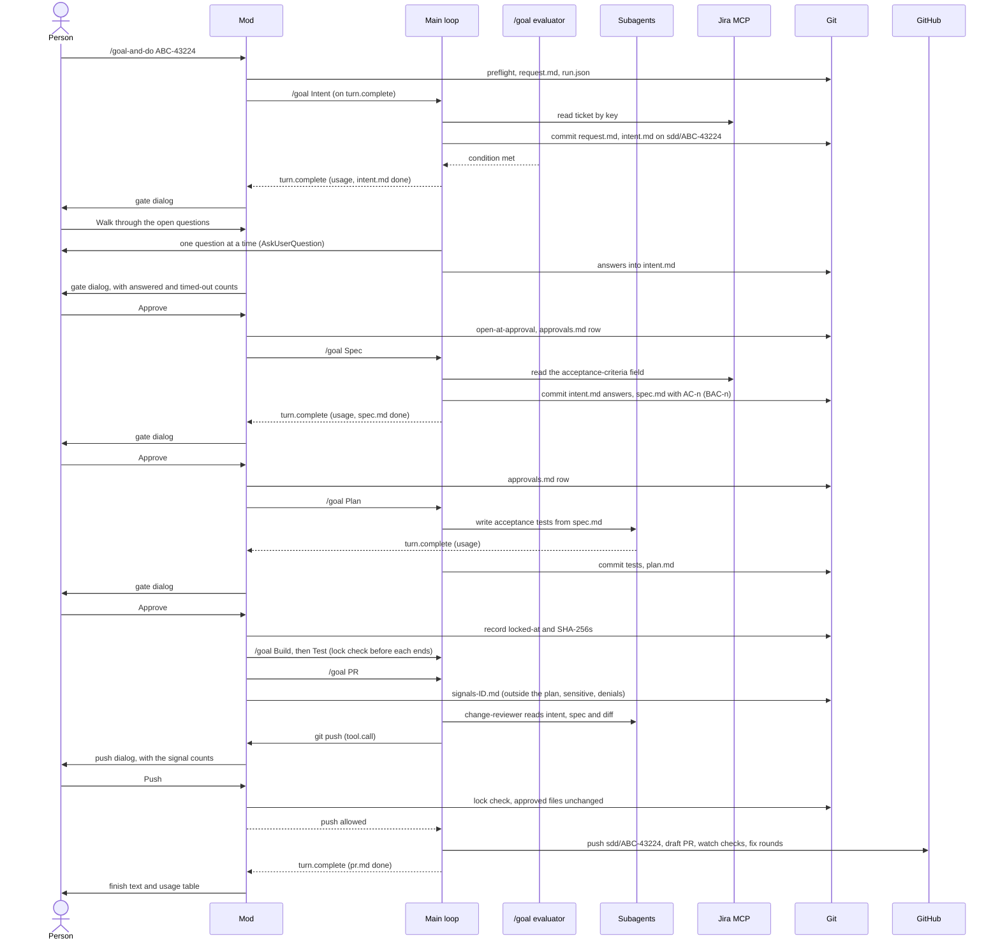

# goal-and-do - Design

## About this document

This is the design of `goal-and-do`, a prototype for private trials: each person on their own work, on their own machine. It isn't ready for a team rollout. A team rollout waits for the answers to open questions 1 and 6.

Audience: reviewers who read it beside the code. It fixes the decisions and names the deviations from a stricter design. The exact texts and shapes live in the code; the contracts at the end point there.

## Context

The approach is goal-driven: each phase is a skill that prompts `/goal`, for example "Create a technical plan for ticket ABC-43224 in this repo. The plan must be detailed enough for developers to judge and approve it." That leaves the details to Claude: which skills, which subagents, how to split the work. Six phases (Intent, Spec, Plan, Build, Test, and PR) give six goals.

This prototype makes that approach run end to end, barebones: one command takes a Jira ticket or free text and leads through the six phases, with three gates for a person. It shows progress on screen, learns permissions, and counts tokens and models per phase, so prototypes can be scored against each other.

The Intent phase writes the change's business intent: its problem, outcome, and business acceptance criteria. Its `BAC-` IDs belong to the change.

Preconditions: Claude Code 2.1.314; a trusted folder; no `allowManagedHooksOnly`, `allowManagedModsOnly` or `disableAllHooks` in managed settings. Anything this prototype shows holds for unmanaged machines only.

### Deviations From a Stricter Design

Each deviation, with its reason:

| # | A stricter design says | This prototype | Why |
|---|---|---|---|
| 1 | No gate or deciding check lives only in a mod | The gates, the guard and the phase driver live only in the mod | It tests a mod as conductor |
| 2 | A person starts each step | Build, Test and PR start without a person | The author's gate choice |
| 3 | Each step starts with a fresh context | One session context for all phases | Unless the mod can clear the context between goals |
| 4 | The PR step marks the pull request ready for review | The PR stays a draft | The author's answer |
| 5 | A step that read a ticket asks a person before it pushes | One dialog before the first push | The author's answer |
| 6 | A step writes the acceptance tests before Build; they lock at spec approval | The Plan phase writes them through a fresh subagent; they lock at Plan approval | Keeps the phases; the subagent sees only the spec and the planned interfaces |
| 7 | Fixes go back to Build, and a person decides each | The PR phase fixes failing checks itself, at most 3 rounds | The author asked for "monitoring the PR build and fix failing tests" |
| 8 | Approvals bind to file hashes in GitHub reviews | Terminal approvals, recorded with each file's SHA-256 in `approvals.md`; the person who ran the phases approves them, `intent.md` included, not a product owner, and `intent.md` says `agreed-by: developer` | Bare minimum |
| 9 | Regulatory change fields, team layer, CI checks | Only `adds-ai-feature` kept; no team layer, no CI checks shipped | Bare minimum |
| 10 | The start check needs auto and bypass mode off | Runs in default and auto mode | The author works in auto mode |
| 11 | A project guidelines file and a validation skill | The project's `CLAUDE.md`; a short preflight at start | Bare minimum; no new file for a project to write |
| 12 | Work starts at the spec | A short Intent phase before Spec, with its own gate | It tests a developer's step before the spec, and the run measures its cost against Spec alone |

The intent format: `intent.md` has Problem, Outcome, Business acceptance criteria, Users, Constraints, and Open questions, and Spec traces each criterion as `AC-<n> (BAC-<n>)`. Its front matter holds what the mod and Spec read; a section for departures from the ticket lets the PR show them. Intent reads no code before the problem is confirmed, and "not proceeding" counts as a successful outcome: a blocked Intent asks instead of guessing.

### Out of scope

- A team rollout and any central collection. In the private trials, every record (`run.json`, the pane, the usage table) stays on the tester's machine: never committed, never collected, no telemetry export.
- A company's platform controls. The prototype runs under the developer's identity and Claude Code's own permission checks. It has no AI gateway, version registry, SIEM, workload identity, MCP logging or prompt protection service. Check your organization's rules before you use it.
- A redo command, and a way back from Plan to Spec: "Not yet", edits in chat and `next` cover a gate.
- A team layer, customization and configuration. Templates only as a project's own `intent.md` and `spec.md` template.

### Key decisions locked in

1. **The mod runs the phases, the skills hold the method.** The Skill tool refuses `/goal` (verified October 24, 2026 on 2.1.310; the spike rechecks it on 2.1.312). If the spike shows that `ProposeGoal` lets a skill set its own goal, the author decides before any mod code whether the skills set their goals, as first asked.
2. **Goals start from `turn.complete`,** not inside a `command.run` hook.
3. **Every goal ends on `status: done` or `status: blocked`** in its phase file's front matter, and shows its evidence in the conversation: the `/goal` evaluator judges only the conversation.
4. **The model attests its own phase file; the mod runs the deterministic checks.** At Plan approval it records the commit (`locked-at`) and each locked file's SHA-256. Before Build and Test end, and before the push, it checks that the acceptance tests haven't changed since, and stops the run if they have.
5. **The mod counts turns.** At a phase's cap it clears the goal and marks the phase `capped`; `stop` clears the goal; `next` refuses while a goal runs. A run restored mid-phase shows `interrupted`: `session.start` doesn't say whether a session resumed, so `next` reruns the phase either way.
6. **A guard on every tool call during a run,** failing closed: the only push is `git push origin sdd/<id>` in the PR phase. It is best effort; branch protection on the target repo is the real control.
7. **Tokens come from `turn.complete`'s usage,** main loop and subagents alike. A turn's tokens go to its last model. Turns while the run waits at a phase get their own rows.
8. **Permission learning is an allow-list,** only for calls a person was asked about and allowed, offered right after the answer. It adds MCP tools, the shared project scope and one batched offer over Claude Code's own "don't ask again". In auto mode it is rare. Learned rules persist; shared project rules apply after each teammate trusts the folder.
9. **Facts the docs and types already give:** installed mods are on by default; setting a goal starts a turn at once; a new goal replaces an active one; the evaluator is a session-scoped Stop hook on a small fast model; a `turn.complete` text other than the answer shows beneath it.
10. **Layout.** Mods need `hooks/`, `types/` and a `tsconfig.json`; the skills get no contributor `README.md`; the skills set `user-invocable: false`.
11. **A departure from a criterion is written back into `spec.md` at the Plan gate.** Plan can find that a criterion cannot hold as written. The plan-change skill records such a gap as an open point that starts with `Departure AC-<n>:` and never edits `spec.md`. When the person decides that point in the gate's walk-through, Claude writes one line into `spec.md` under that AC with its Edit tool, from the person's words. The AC's heading and its Given, When and Then lines stay as approved. No second approval step exists: the gate already approves an edited earlier file again. A departure from the front matter (`adds-ai-feature`) is not an AC line and stays outside this: the person edits it by hand at the gate, and the same rule approves it.
12. **A run has a guard level,** `strict` or `review`, kept in `run.json`. The guard judges a call the same way at both levels; the level decides only what a denial does to the run. At `strict`, a denial of a named environment file, a credential store, a steering file, an outbound channel or an MCP write ends the run blocked. At `review`, the default, the call stays denied and the run goes on, with the denial counted and listed (at most 200 calls, the command text with its secret shapes removed). A start line without `--strict` runs at `review` and says so once, in a toast and a transcript line; a measured run starts with `--strict`. The mod's own blocks (tests changed since the lock, approvals that differ, changed Git settings, a declined push, a guard that fails) end the run at both levels. The person switches an active run with `level strict|review`, and each switch is logged with its time. A level that is missing or is anything but `review` restores as `strict`. The mod keeps the level in its store beside the approvals record (`level:<id>`, written at the start and at each switch), and a run restores at `review` only when `run.json` and the store both say so, since a write to `run.json` that gets past the best-effort guard could otherwise lift a strict run to review.

## Approach

### High-level flow



A rerun goes back to the phase that got stuck; the arrow to Spec stands for all six. The PR phase's fix cap adds a stuck state of its own: a fourth push with a `fix(<id>):` commit is refused, the run is blocked, and the dialog offers rerun (count and cap unchanged), reset the count, and raise the cap by 3 (never above 9), then stop. A blocked Intent asks whether to stop first, because there a block can be the right result. Every main-loop turn after a person answered a permission prompt may bring the rule dialogs.

### Sequence diagram



### Departures at the Plan gate

The path of a decided departure, from the gap to the second Spec row. The line's form is in Technical details.

```mermaid
sequenceDiagram
    actor Person
    participant Mod
    participant Main as Main loop
    participant Git
    Main->>Git: plan.md: Gaps found, and an open point "Departure AC-9: ..." for a gap that changes AC-9
    Main-->>Mod: turn.complete (plan.md done)
    Mod->>Person: Plan gate dialog, with the open points counted
    Person->>Mod: Walk through the open points
    Mod->>Main: walk-through prompt for plan.md (with the Departure form)
    Main->>Person: the point, a recommendation, options (AskUserQuestion)
    Person->>Main: the decision
    Main->>Git: "Decided (the person, <date>): ..." under the point in plan.md
    Main->>Git: "Departure (<date>, decided at the Plan gate): ..." under AC-9 in spec.md (Edit tool)
    Main-->>Mod: turn.complete (the walk-through's turn ends)
    Mod->>Person: Plan gate dialog again: "spec.md changed since its approval; approving also approves the current spec.md"
    Person->>Mod: Approve
    Mod->>Git: approvals.md: a second Spec row with the new hash, then the Plan row
```

A point the person skips or declines writes no line. If a file moves while the dialog is open, the dialog opens again naming that file, so the approval always covers what was shown. The push check compares each phase's last row, so the new Spec row keeps it quiet.

### Shared state

- **In the target project:** `changes/<id>/` with `request.md`, `intent.md`, `spec.md`, `plan.md`, `approvals.md`, `build.md`, `test.md`, `pr.md` (each committed by its phase; `spec.md` also gains a Departure line when the Plan gate decides one) and `run.json` (never committed; in `.git/info/exclude`). Branch `sdd/<id>` from origin's default branch, or from the branch `--base` (or a request file's `base:`) names; Intent creates it. The acceptance tests. Learned rules in `.claude/settings.json` or `.claude/settings.local.json`.
- **On GitHub:** one draft PR and its CI runs. Nothing merges.
- **External systems and their connectors:** Jira through a Jira MCP from an approved source, its token from `JIRA_PAT`; GitHub through `gh`, logged in through the browser; Jenkins logs through a Jenkins MCP. The plugin ships no MCP server.
- **Counts** score prototypes, never people. `run.json` holds no user name, and the counts never go into a commit of the target project, the PR or Jira.

### Pane

The mod only displays. Four skills change: Plan writes two fields; Build and Test run the test command as before; PR lists the mod's signals. Nothing in the pane gates or changes the run's state; the one new deny is a safety fix, the guard's `git config` rule.

The pane's header is the run's ID, folded at the start. Opened, it shows what the person asked for: a ticket's browse URL as a link labeled with its key, a key alone as text (the mod knows no Jira address), a request file's path as a button that opens it, or the free text, wrapped, up to 10 rows, then a button that opens `request.md`.

Each row of the phase table shows "5/7 open" for its undecided open points against all of them, until approved; the current phase reads "running" while its goal works, whatever its file says, and the phase at its gate reads "to approve" until the person approves it. Under the table comes the Requirements chain (`BAC-1 → AC-1, AC-2`, from the Spec gate on), where a press on an ID opens its criterion's text. Then the sections below, in the author's order, with Recent Files (the last five file events, newest first, a change-folder file by its name; reads outside the project leave the list) after Changed Files, then the suggested rules, each as its command and what the rule allows, and the denials last. A bold header, led by ▼ when open and ► when folded, folds and unfolds the chain, Recent Files, the two path lists, the denials and the suggested rules; the choice holds for the session, in memory. Headings use title case. The pane draws no turn line: the band above the prompt shows the turns.

| # | Label | When it shows |
|---|---|---|
| 1 | Blocked | In a blocked or capped state: the reason as a fixed text, else "blocked: see Open points in `<file>`" |
| 2 | Changed Files | From Build on: files and lines since the branch point, in three groups (tests, CI, the rest); "Outside the Plan" and "Sensitive Files," up to five paths each |
| 3 | Tests | The last run of the stored `test-command` (passed, failed, interrupted, started, or "ran; result not readable"), with its time; the AC marks "per test.md"; the lock line |
| 4 | Denials | In every active state, last: the guard's last three denials under a foldable "Denials (n)" header |
| 5 | Guard Level | In every active state, right above Denials: `Guard level: strict` or `Guard level: review`. The band shows `review` after the state at that level only, with `N denied` once a denial happened; a strict run's band is as it was |

Inline at 80 columns, the most urgent line (the blocked line, else the last denial) goes first. To fit, the pane drops the tokens column, the path lists and the open-point counts, in that order; a line still too wide wraps at word boundaries, indented by two spaces. The denial lines wrap too and drop only in a pane under 20 columns, where they go after the path lists. A blank line separates the header from the phase table, and the table from each section. The current phase's row is bold while the run is active.

A dialog hides the band, and Claude Code does not tell the mod when the person collapses the band. The mod counts the dialogs it can see (its own and Claude's `AskUserQuestion` calls, in the in-memory `dialogs` atom). While the count is above 0, the pane draws the band's turn and state part under its header, without the phase chain the table shows.

It never shows command text, ticket text, names, model-written reasons, or raw paths, and strips control characters. The pane and the new `run.json` fields stay on the person's machine. They hold no names, never go into a commit, the PR or Jira, and go with `changes/<id>/`. Like the counts, they score prototypes, never people.

## Open questions

1. Does your organization need a registration or risk assessment before an AI use case's Build phase, and does it apply to such a prototype?
2. Should a gate offer a way back from Plan to Spec?
3. Do names in tickets count as personal data?
4. Does the `/goal` evaluator honor a turn cap, and what counts as a turn? What is `/goal`'s argument limit? (The goal texts stay under `ProposeGoal`'s 500 characters.)
5. Do the evaluator's tokens reach `turn.complete`?
6. Before any team use in Germany: is the pane, with `run.json`, a device under § 87 (1) no. 6 BetrVG? Labor relations decides.

## Technical details

One line per contract; the code holds the exact shapes and texts.

- **Command:** `/goal-and-do [--strict] [--base <branch>] <ticket URL | key | text | file.md> | level strict|review | next | status | allow [local] | stop`; a start, `level`, `next` and `allow` only when a person typed them. `--strict` (the first word, or right after `--base <branch>`) starts the run at `strict`, in either order with `--base`; after a ticket, a subcommand or a `.md` path, alone, before a subcommand, given twice, or as `--strict=<value>` it refuses the start, and inside a request it is plain text. `level` switches an active run at any time, also while a goal turn runs, since it starts no goal. `--base` (the first word, before a request) names a branch on origin to start from, checked with `git check-ref-format --branch` and fetched by an explicit refspec with `GIT_SSH_COMMAND` and `GIT_SSH` unset, `core.sshCommand=ssh -o BatchMode=yes`, no prompt and a 30-second limit; a fetch that fails or runs out of time refuses the start; `--base` after a ticket, a subcommand or a `.md` path refuses too; a one-word input ending in `.md` names a request file inside the project, else the start is refused; its front matter holds only `base:`, the clean-tree check (`git status --porcelain -z`) leaves that file out while it is untracked (a tracked one must be committed first), and a refusal shows each dirty file's name only when it is plain, and request.md then adds `from-file:`. A handler that fails answers a fixed line. What `next` does in each state: `nextAction` in `hooks/phases.ts`.
- **Run states:** `running`, `gate`, `blocked`, `capped`, `interrupted` (all active: band and guard on), `stopped`, `finished`. Transitions: `hooks/phases.ts`.
- **Goal texts, band, dialogs and every person-facing text:** `GOALS` and `TEXTS` in `hooks/phases.ts`, tested verbatim.
- **Phase files:** front matter `phase`, `status: draft | done | blocked`, plus per phase `source`, `base`, `issue-type`, `ticket-url`, `ticket-updated`, `agreed-by: developer`, `high-risk`, `format: 1`, and `open-at-approval` from the mod (intent); `source`, `issue-type`, `base`, `adds-ai-feature`, `high-risk` (spec); `tests-commit`, `test-paths`, `planned-paths`, `test-command` (plan); `pr-url`, `checks`, `fix-rounds`, `draft-at-create: yes | no | unreadable` (pr; the mod reads the last for the end-of-run warning, and a missing line counts as created as a draft). Written by the skills in `skills/`.
- **`intent.md`:** the sections above; each criterion `- BAC-<n>: Given …, when …, then …`, never renumbered, a dropped one marked `(dropped)`; each answer from the walk-through `Answer (<date>): "<text>"`, deciding its point unless it starts with `Not known yet`. Spec writes `AC-<n> (BAC-<n>)` or `AC-<n> (none)`, and a criterion it puts out of scope as `- BAC-<n> (out of scope): <reason>`. One parser of `test.md`'s table: `acResults`.
- **Templates:** a project's `.claude/intent/intent-template.md` and `.claude/spec/spec-template.md` replace the built-in ones in `skills/write-intent/assets/` and `skills/write-spec/assets/`, one template per repository, so per business area. A template may add and reorder sections. It keeps the front matter, the section names the phase's goal checks (for `intent.md`: Problem, Outcome, Business acceptance criteria, Users, Constraints, Open questions), the `BAC-<n>` and `AC-<n> (BAC-<n>)` lines, Open points, and Out of scope, which the mod and the next phase read.
- **High-risk list:** `high-risk.md` in `skills/write-intent/assets/`, plus a project's additions in `.claude/intent/high-risk.md`; a project can't remove a line. Intent writes `high-risk: <items> | none` into `intent.md`'s front matter and one open question per item touched. Spec copies the field, and the PR body's Focus areas names each item. With one pipeline, the list forces no lane.
- **Extra sections:** `spec.md` has `## Edge cases`, each naming its AC, with a compliance skill's result when the organisation provides one. `plan.md` has `## Gaps found`: facts across `intent.md`, `spec.md`, the plan and the code that don't agree; a gap that changes a criterion is also an open point that starts with `Departure AC-<n>:`.
- **PR body:** the repository's PR template when it has one (`pull_request_template.md` at the root, in `docs/` or `.github/`, or in `.github/PULL_REQUEST_TEMPLATE/`), with the AI-authorship line first and the AI review's findings, the decision tables, To Do and Approvals added where the template has no heading for them; else the ABC `create-or-update-pr` structure.
- **The Departure line in `spec.md`:** `Departure (<date>, decided at the Plan gate): <what was decided and why>`, written during the Plan gate's walk-through and only for a decided point. It is unindented, after a blank line, below the last line of its AC's block and below any Departure already there; the AC's heading and Given, When and Then lines are untouched. `acBlocksOf`, `traceRows` and `outOfScopeIn` read headings and `Out of scope` list items only, and `criterionTexts` ends an AC's text at a line that is no step, so none of them reads the line; an indented line right under a step with no blank line would be appended to that step, which the form rules out. The date is the walk-through's. The guard allows the Edit: `spec.md` is no locked test, `approvals.md` or `run.json`.
- **PR phase rules (from CH-20261102-read-ci-checks-right-cap-fix):** three pure modules hold them, so tests need no `gh` or Git. `hooks/prchecks.ts` reads the rows of `gh pr checks sdd/<id> --json name,bucket,state,link` and never the exit code of `gh`; `state` is read before `bucket` (`NEUTRAL` and `CANCELLED` go to To Do whatever the bucket says), a failed Jenkins check whose build cannot be found goes to To Do as "build unreadable", and a failed check whose log holds an entry of `skills/open-pr/assets/infrastructure-patterns.txt` (case-insensitive substring, first match in list order) goes to To Do as "re-run by hand" with the entry named and starts no fix round; the list belongs to the plugin's code owner and changes by pull request only. `hooks/fixpushes.ts` holds the one count of fix pushes: a push that went through counts once when one of its new commits starts with `fix(<id>):`; at the cap such a push is refused (checked before the push dialog and again right before the push is rewritten, on the commits beyond `origin/sdd/<id>`, else beyond `origin/<base>`; a push whose commits Git cannot list is refused), while the record push passes. Each stuck choice is appended to `goal-and-do/fix-choices-<id>.log` in the Git directory, never to a commit, the PR or Jira. `hooks/prrecord.ts` decides the draft state right after `gh pr create` (`isDraft: false` stops the phase and a person converts it, the agent never does; an unreadable state is read once more after 10 seconds), compares the live PR description with the written one (line endings and trailing whitespace ignored) and keeps a person's edit, with a note in `pr.md`, and matches the PR's `headRefOid` with the pushed commit (up to five re-reads 60 seconds apart, then a To Do line naming both commits and `checks: none`). The exact forms `gh pr view sdd/<id> --json headRefOid,statusCheckRollup`, `--json isDraft` and `--json body` need no permission prompt; any other flag, branch or word asks.
- **Turn caps:** Intent 10, Spec 15, Plan 20, Build 40, Test 25, PR 60 (`TURN_CAPS`).
- **`approvals.md`:** one row per approval: phase, file, SHA-256, `git config user.name`, time, and `locked-at` for Plan. The mod keeps the rows in its store, beside the test lock, and rewrites the file whole from them at each approval; Build commits it. Restore refuses an active run whose `run.json` differs from the store or has no entry there. Before the push the mod checks `intent.md`, `spec.md` and `plan.md` against the store's last approved SHA-256, and `approvals.md` against the store's rows.
- **`run.json`:** `Run` in `types/index.d.ts`, schema 2, with an integer phase from 0 to 5. A finished or stopped schema-1 run is skipped; an active one is refused, with a way out. New optional fields: `denials` (reason keys), `lastTests` (with its phase), `lastLockCheck`, the stored `plannedPaths` and `testCommand`; restore drops the first three. `fixPushes` and `fixCap` are required numbers (0 and 3 at the start); a `run.json` without them, or with a count below 0 or a cap outside 3 to 9, loads as 0 and 3. The guard level adds `guardLevel`, `deniedCalls` (review level only: phase, key, tool, time and the redacted command, in order, at most 200) and `levelChanges` (`{at, from, to}` per switch); restore keeps all three and reads `guardLevel` through `guardLevelOf`, so only the exact value `review`, confirmed by the store's `level:<id>` entry, restores as review. In memory only: the `trace`, `turn`, `footprint`, `dialogs`, `recent`, `folds`, `criteria` and `opened` atoms.
- **Guard:** `guard` in `hooks/guard.ts`, one reason text per rule. It judges every tool that runs a shell command (`Bash`, `Monitor`) like `Bash`, and an edit by its real path, after symlinks. In the Intent phase it allows only an allow-list of tools; edits only under `changes/<id>/`, by absolute path; shell commands only Git for the branch and the change folder; and MCP tools only Jira reads. A Jira server's name holds `jira` or `atlassian`; a read starts with `get`, `search`, `read`, `jira_get_` or `jira_search`, holds no `confluence` and no write verb (ABC's `tool-detection.md` at `e26b4d3b`, Sections 2 and 6). The preflight uses the same rule. In every phase it denies edits to `approvals.md` and shell commands that write `approvals.md` or `run.json`, and during a run, outside Intent, `git config` and `git -c` for `core.fsmonitor`, `core.hooksPath`, `diff.*`, `filter.*`, `include.*` and `includeIf.*`, edits anywhere under `.git/` except `.git/goal-and-do/`, and shell commands that reach `.git/config`, `.git/info/`, `.git/hooks/` or `.git/modules/`; edits and shell commands that reach the mod's store are denied in every phase, and so is an edit whose path the mod can't place. While a run is active (and not refused) it denies setting a timer (`ScheduleWakeup` other than `stop: true`, `CronCreate`). A PR's `--body-file` may name the run's own `.git/goal-and-do/pr-body-<id>.md` or a file under `changes/<id>/`, and `gh pr create` needs `--base` with the run's base. In the PR phase, at both levels, `gh auth status` alone and `gh api <relative endpoint>` pass, the latter as a GET with only `--paginate`, `--jq` and `--include`; any other method, fields, `--input`, `--hostname`, headers, a URL and `graphql` stay refused; for every `gh` form of the PR phase, a word with a `$` or a backquote, a `--jq` filter that reads the environment and a redirecting variable in front (`isRedirectEnv`, one pattern shared with the export check; `GH_PAGER=cat` passes) are refused too, and so do a `--jq` filter that reads the environment and a `GH_*`, `GITHUB_*` or proxy variable in front of `gh`. The guard level wraps the guard in `hooks/level.ts`: `guardAt` gives the guard's verdict with its reason keyed and whether a denial blocks at the run's level, and `afterDenial` counts, lists and, at `strict`, ends the run.
- **Git calls of the mod:** argv through `sh()`, with `-c core.fsmonitor=false -c core.untrackedCache=false -c diff.external= --no-pager`, `--no-ext-diff --no-textconv` on diff, and `GIT_CONFIG_NOSYSTEM=1` (the fingerprint's own config read leaves it off, so system-scope entries count). Calls that read the working tree first read the filters the repository's own config defines (local and worktree scope) and switch each off for that call, except Git LFS's standard values, and skip submodules' dirty state; the user's global and system filters stay on, and the fingerprint catches one added during a run at the next gate. At the start the mod records a fingerprint of Git's whole config (every entry at every scope except `branch.*`, `remote.*.fetch`, `remote.*.gh-resolved` and `lfs.repositoryformatversion`), its hooks with their content, and its attributes in its store, and checks it at each gate, before the push, after the person's answer, and after the push; a change blocks the run. It also records origin's push URL. The allowed push is rewritten to `command env -u <GIT_SSH_COMMAND and similar variables> git -C '<project root>' -c core.hooksPath=/dev/null -c core.sshCommand=ssh push --no-verify`, to that recorded URL itself, in the foreground. Writes of `run.json` go through one ordered writer. The footprint uses `--no-renames`, so a move shows as a delete and an add.
- **Signals for the PR:** `goal-and-do/signals-<id>.md` at the path `git rev-parse --git-path` gives, which the mod writes when the PR goal starts and `open-pr` reads; the counts only, and up to five plain paths per flag. `open-pr` writes the run's own `pr-title-<id>.txt` and `pr-body-<id>.md` there, whole.
- **Comparability:** Plan now writes `test-command` and Intent comes first, so the Spec row isn't comparable with runs before October 30, 2026; Plan to PR are.
- **Learned rules:** `ruleFor`, `shouldSuggest`, `mergeAllowRules`, `ruleLabel`, `describeRule` in `hooks/permissions.ts`; the rule dialog's option descriptions go in through the mod's `ui.render` hook on `AskUserQuestion`.
- **Usage measure `usage-1`:** per row (phase, rerun, waiting) and model: input, output, cache read, cache write, total; per row: input plus output, turns, active minutes; the Claude Code version, plugin version, provider and permission mode beside it. What it counts and misses stands under the table. `hooks/usage.ts`.
